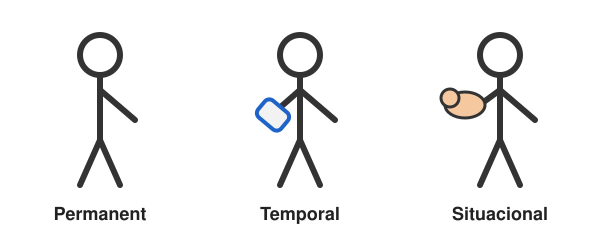
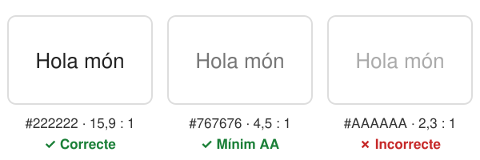
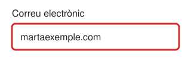
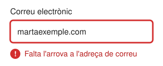
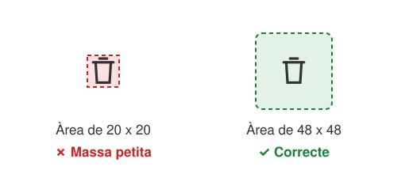
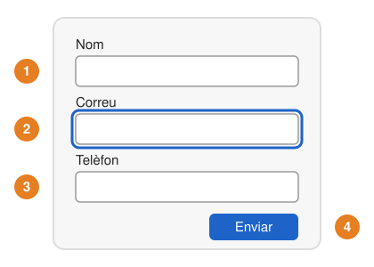

<div style="display: flex; width: 100%;">
    <div style="flex: 1; padding: 0px;">
        <p>© Albert Palacios Jiménez, 2026</p>
    </div>
    <div style="flex: 1; padding: 0px; text-align: right;">
        
    </div>
</div>
<br/>

# Accessibilitat

L'**accessibilitat** és la capacitat d'un programa de ser utilitzat per **totes les persones**, incloses les que tenen alguna discapacitat.

Una aplicació accessible no és una aplicació diferent o "especial", és una aplicació ben dissenyada. Moltes de les decisions de les lliçons anteriors (contrast, mida dels textos, espaiat, animacions) també són decisions d'accessibilitat.

L'accessibilitat no afecta només a una minoria. Les limitacions poden ser:

- **Permanents**: una persona cega, o sense un braç
- **Temporals**: un braç enguixat, una operació d'ulls
- **Situacionals**: el sol que enlluerna la pantalla, portar un nadó en braços, un lloc sorollós on no se sent el vídeo

<style>
.image-container {
    display: flex;
    justify-content: space-between;
    width: 100%;
}

.image-item {
    display: flex;
    flex-grow: 1;
    flex-direction: column;
    padding: 0px;
    display: flex;
    justify-content: center;
    align-items: center;
}

.image-item img {
    max-height: 250px;
    height: auto;
    width: auto;
    max-width: 90%;
}

.image-item div {
    color: #444444;
    text-align: center;
}
</style>
<center>
<br/><div style="color: #444444;">Una mateixa limitació, de tres maneres diferents</div></center>
<br/><br/>

## Tipus de discapacitats

| Tipus       | Exemples                                     | Què necessita la interfície                                   |
|-------------|----------------------------------------------|---------------------------------------------------------------|
| Visual      | Ceguesa, baixa visió, daltonisme             | Lector de pantalla, bon contrast, textos escalables, no dependre del color |
| Auditiva    | Sordesa, pèrdua auditiva                     | Subtítols, avisos visuals a més dels sonors                   |
| Motriu      | Tremolors, mobilitat reduïda, un sol braç    | Botons grans, navegació amb teclat, no exigir gestos complexos |
| Cognitiva   | Dislèxia, TDAH, problemes de memòria         | Llenguatge clar, passos curts, temps suficient, errors entenedors |

**Curiositat**: aproximadament un 8% dels homes i un 0,5% de les dones tenen algun tipus de daltonisme.

## Pautes WCAG

Les **[WCAG](https://www.w3.org/TR/WCAG22/)** (Web Content Accessibility Guidelines) són les pautes d'accessibilitat del W3C. Tot i que van néixer per al web, es fan servir com a referència per a qualsevol interfície: aplicacions d'escriptori, mòbils, …

Les pautes s'organitzen en quatre principis (**POUR**):

- **Perceptible**: la informació s'ha de poder percebre (veure, sentir o tocar)
- **Operable**: la interfície s'ha de poder fer servir (ratolí, teclat, tàctil, veu)
- **Comprensible**: la informació i el funcionament s'han d'entendre
- **Robust**: ha de funcionar amb les eines d'assistència (lectors de pantalla, …)

Cada pauta té un nivell de compliment:

| Nivell  | Significat                                                    |
|---------|---------------------------------------------------------------|
| **A**   | Mínim imprescindible                                          |
| **AA**  | Nivell recomanat, és el que demanen les lleis                 |
| **AAA** | Nivell màxim, no sempre és possible aconseguir-lo             |

**Important**: a la Unió Europea, l'**[Acta Europea d'Accessibilitat](https://commission.europa.eu/strategy-and-policy/policies/justice-and-fundamental-rights/disability/union-equality-strategy-rights-persons-disabilities-2021-2030/european-accessibility-act_en)** obliga des del juny de 2025 que molts productes i serveis digitals (botigues online, banca, transport, llibres electrònics, …) siguin accessibles. Les administracions públiques ja tenien aquesta obligació des de 2018.

## Contrast

A la lliçó de colors hem vist que el contrast fa que els textos es llegeixin bé. Les WCAG defineixen uns **mínims de contrast** (nivell AA):

| Element                                          | Contrast mínim |
|--------------------------------------------------|----------------|
| Text normal                                      | **4,5 : 1**    |
| Text gran (24px, o 19px en negreta)              | **3 : 1**      |
| Icones, vores de camps i components interactius  | **3 : 1**      |

El contrast va de **1:1** (mateix color) a **21:1** (negre sobre blanc).

<center>
<br/><div style="color: #444444;">El gris #767676 és el gris més clar que es pot fer servir sobre blanc</div></center>
<br/>

No cal calcular el contrast a mà, hi ha eines que ho fan:

- [WebAIM Contrast Checker](https://webaim.org/resources/contrastchecker/)
- Les eines de desenvolupament dels navegadors (Chrome, Firefox, Safari)
- Els inspectors d'accessibilitat de Xcode i Android Studio

**Atenció**: cal comprovar el contrast en els **modes clar i fosc**, un color que funciona en un mode pot no funcionar en l'altre.

## No dependre només del color

El color no pot ser l'**única** manera de donar informació. Una persona daltònica, o una pantalla en blanc i negre, perd aquesta informació.

Per exemple, un camp de formulari amb un error, s'ha de marcar amb color, però també amb una icona i un text:

<div class="image-container">
    <div class="image-item">
        
        <div>Incorrecte, només color</div>
    </div>
    <div class="image-item">
        
        <div>Correcte, color + icona + text</div>
    </div>
</div>
<br/>

Altres exemples:

- Els enllaços d'un text, a més de color, poden anar subratllats
- Els gràfics poden fer servir patrons o etiquetes, a més de colors
- Els estats "actiu/inactiu" poden fer servir icones o textos, a més de colors

## Mida dels textos

Els usuaris han de poder **fer més grans els textos** des de la configuració del sistema, i l'aplicació s'ha d'adaptar sense trencar-se.

- iOS i macOS: *Dynamic Type*
- Android: *Mida de la font* a la configuració
- Web: zoom del navegador, fins al **200%**

Per aconseguir-ho:

- No fixar alçades a les caixes de text, deixar que creixin
- Fer servir les mides de font del sistema (o unitats relatives)
- Comprovar l'aplicació amb la mida de text més gran

## Mida dels elements tàctils

A la lliçó de mòbils hem vist que els elements seleccionables han de tenir una mida mínima. Les persones amb tremolors, o que fan servir el telèfon caminant, ho agraeixen especialment.

| Guia                      | Mida mínima                        |
|---------------------------|------------------------------------|
| WCAG 2.2 (nivell AA)      | 24 x 24 píxels                     |
| WCAG 2.2 (nivell AAA)     | 44 x 44 píxels                     |
| Apple                     | 44 x 44 punts                      |
| Material Design (Android) | 48 x 48 dp                         |

<center>
<br/><div style="color: #444444;">La icona pot ser petita, però l'àrea que es pot tocar ha de ser gran</div></center>
<br/>

A més de la mida, cal que hi hagi **espai entre els elements** per no tocar el botó del costat per error.

## Navegació amb teclat

Moltes persones no poden fer servir el ratolí o la pantalla tàctil, i naveguen amb el **teclat** (o amb dispositius que simulen un teclat).

- Tots els elements interactius han de ser accessibles amb la tecla **Tab**
- L'**ordre del focus** ha de seguir l'ordre visual (d'esquerra a dreta i de dalt a baix)
- L'element que té el focus s'ha de **veure clarament** (vora, color, …)
- No hi pot haver **trampes de teclat**: si s'entra en un element amb Tab, se n'ha de poder sortir
- Les accions principals han de tenir **dreceres** (Enter per acceptar, Escape per cancel·lar, …)

<center>
<br/><div style="color: #444444;">Ordre del focus amb la tecla Tab, i focus visible</div></center>
<br/>

**Exercici ràpid**: desendolla el ratolí i intenta fer servir la teva aplicació només amb el teclat.

## Lectors de pantalla

Un **lector de pantalla** és un programa que llegeix en veu alta el contingut de la pantalla, i permet navegar-hi amb el teclat o amb gestos.

| Sistema   | Lector de pantalla |
|-----------|--------------------|
| macOS/iOS | VoiceOver          |
| Android   | TalkBack           |
| Windows   | Narrador, NVDA     |
| Linux     | Orca               |

El lector de pantalla només pot llegir el que l'aplicació li diu. Per això cal:

- Que les **imatges** tinguin una descripció (text alternatiu)
- Que els **botons amb icona** tinguin un nom ("Esborrar", no "botó")
- Que les imatges **decoratives** s'amaguin al lector, perquè no aporten informació
- Que els **títols** estiguin marcats com a títols, per poder saltar de secció en secció

Una bona descripció explica **què aporta** la imatge, no com és:

| Imatge                         | Descripció dolenta | Descripció bona                       |
|--------------------------------|--------------------|---------------------------------------|
| Icona de paperera en un botó   | "paperera.png"     | "Esborrar"                            |
| Foto del perfil d'un usuari    | "imatge"           | "Foto de perfil de la Marta"          |
| Gràfic de vendes               | "gràfic"           | "Les vendes han pujat un 20% al març" |

### Com es fa a JavaFX

A JavaFX, cada element té el mètode `setAccessibleText`:

```java
Button delete = new Button();
delete.setGraphic(new ImageView("trash.png"));
delete.setAccessibleText("Esborrar");
```

### Com es fa a Flutter

A Flutter, les imatges tenen `semanticLabel`, i els botons amb icona fan servir el `tooltip`:

```dart
IconButton(
  icon: Icon(Icons.delete),
  tooltip: 'Esborrar',
  onPressed: () {},
)
```

Per a qualsevol altre element, es pot fer servir el widget `Semantics`:

```dart
Semantics(
  label: 'Vendes del mes de març',
  child: SalesChart(),
)
```

## Animacions i moviment

A la lliçó d'animacions hem vist que les animacions ajuden a entendre la interfície. Però a algunes persones, el moviment els provoca **marejos** o els **distreu**.

- Els sistemes tenen una opció per **reduir el moviment**, i l'aplicació l'ha de respectar
- No fer **parpelleigs** de més de **3 vegades per segon**, poden provocar atacs d'epilèpsia
- Les animacions llargues o automàtiques s'han de poder **aturar**

A Flutter, es pot saber si l'usuari vol reduir les animacions:

```dart
bool reduce = MediaQuery.disableAnimationsOf(context);
```

## Formularis i errors

- Cada camp ha de tenir una **etiqueta visible**, el text d'exemple (*placeholder*) desapareix quan s'escriu
- Els errors han d'explicar **què ha passat i com arreglar-ho** ("Falta l'arrova al correu", no "Error 42")
- Si hi ha un **temps límit**, l'usuari l'ha de poder allargar
- Les accions importants (pagar, esborrar) s'han de poder **confirmar o desfer**

## Llenguatge clar

- Frases curtes i paraules habituals
- Els botons diuen **què fan** ("Guardar canvis", no "D'acord")
- Les mateixes coses es diuen sempre de la mateixa manera
- Evitar textos en majúscules llargs, són més difícils de llegir

## Com comprovar l'accessibilitat

No cal esperar al final del projecte, es pot comprovar a cada prototip:

- **Teclat**: fer servir l'aplicació sense ratolí
- **Lector de pantalla**: activar VoiceOver, TalkBack o el Narrador, i tancar els ulls
- **Zoom**: posar el text del sistema a la mida més gran
- **Escala de grisos**: activar el filtre de grisos del sistema i comprovar que s'entén tot
- **Eines automàtiques**: Accessibility Inspector (Xcode), Accessibility Scanner (Android), Lighthouse (navegadors)

**Atenció**: les eines automàtiques només detecten una part dels problemes. La millor prova és que persones amb discapacitats facin servir l'aplicació.

## Resum

| Comprovació                                                  | Lliçó relacionada |
|--------------------------------------------------------------|-------------------|
| Contrast mínim de 4,5:1 als textos                           | Colors            |
| La informació no depèn només del color                       | Colors            |
| Els textos es poden fer grans sense trencar la interfície    | Tipografies       |
| Els elements tàctils fan com a mínim 44x44                   | Mòbils            |
| Tot es pot fer amb el teclat, i el focus es veu              | Sobretaula        |
| Les imatges i icones tenen descripció                        | Imatges i vectors |
| Es respecta l'opció de reduir el moviment                    | Animacions        |
| Els errors expliquen com arreglar-los                        | Maquetació        |
