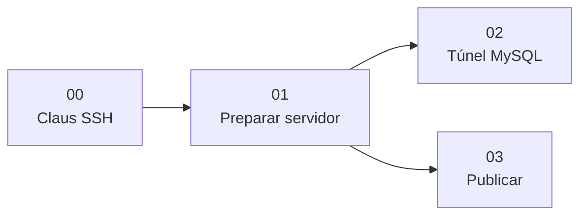

    

        
© Albert Palacios Jiménez, 2024

    

    

        
    

 

# Servidor de l'institut (Proxmox)

**Proxmox** és un sistema de servidor que permet tenir varis contenidors Linux funcionant com a servidors.

Amb el compte de l'institut tens accés a un servidor *Proxmox* personal del centre. Aquesta guia explica com connectar-hi, preparar-lo i publicar-hi una pàgina web amb NodeJS i MySQL.

## Guia pas a pas

Seguiu els documents **per ordre**:

| Document | Contingut | Quan es fa |
|---|---|---|
| [00 - Claus SSH](./guia/00-claus-ssh.md) | Crear les claus, pujar-les a Kamehouse, configurar `config.env` i primera connexió | Un cop per ordinador |
| [01 - Preparar el servidor remot](./guia/01-servidor-remot.md) | Dependències, NodeJS, MySQL i redirecció del port 80 al 3000 | Un cop per servidor |
| [02 - Túnel MySQL](./guia/02-tunel-mysql.md) | Túnel SSH, MySQL Workbench i clonar una base de dades | Cada cop que es treballa amb la base de dades remota |
| [03 - Publicar](./guia/03-publicar.md) | Enviar la pàgina web i arxius al servidor | Cada cop que s'actualitza la pàgina |

Abans de publicar res, la pàgina ha de funcionar al vostre ordinador: [Servidor local amb NodeJS](./guia/servidor-local.md).

Si feu servir Windows, llegiu també [Fer anar els scripts des de Windows](./windows.md).

## Scripts

Tots els scripts s'executen **des del vostre ordinador**, dins la carpeta **"proxmox"**, i llegeixen la configuració de l'arxiu `config.env`.

| Script | Què fa | Document |
|---|---|---|
| `proxmoxConnect.sh` | Obre una consola al servidor remot | [00](./guia/00-claus-ssh.md) |
| `proxmoxSetupRedirect80.sh` | Redirecciona el port 80 al del NodeJS | [01](./guia/01-servidor-remot.md) |
| `proxmoxSetupRedirectUndo.sh` | Desfà la redirecció | [01](./guia/01-servidor-remot.md) |
| `proxmoxTunelStart.sh` | Obre el túnel cap al MySQL remot | [02](./guia/02-tunel-mysql.md) |
| `proxmoxTunelStatus.sh` | Diu si el túnel està obert | [02](./guia/02-tunel-mysql.md) |
| `proxmoxTunelStop.sh` | Atura el túnel | [02](./guia/02-tunel-mysql.md) |
| `proxmoxDeploy.sh` | Envia i publica la pàgina web | [03](./guia/03-publicar.md) |
| `proxmoxSendFile.sh` | Envia un arxiu al servidor remot | [03](./guia/03-publicar.md) |
