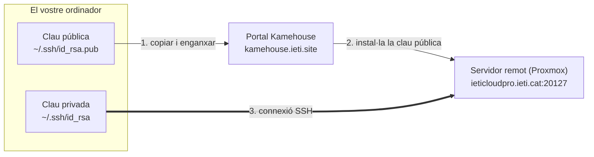
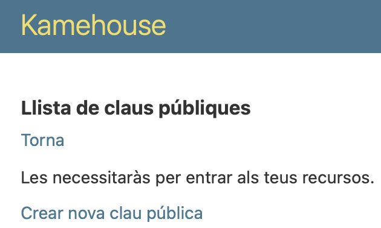
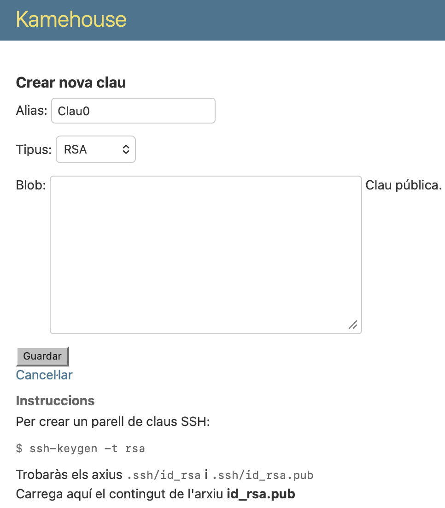

# 00 - Claus SSH i primera connexió

[Tornar a l'índex](../TeoriaProxmox.md) | Següent: [01 - Preparar el servidor remot](./01-servidor-remot.md)

Aquest pas **només es fa un cop per ordinador**. Si treballeu des de dos ordinadors (casa i institut), l'heu de repetir a cadascun.

**Nota:** si feu servir Windows, abans llegiu [Fer anar els scripts des de Windows](../windows.md).

## Com funciona la connexió amb claus

Al servidor remot no s'hi entra amb contrasenya, s'hi entra amb un **parell de claus SSH**:

- La **clau privada** (`id_rsa`) es queda al vostre ordinador i **no s'ha de compartir mai**
- La **clau pública** (`id_rsa.pub`) es puja al portal **Kamehouse** de l'institut, que la instal·la al vostre servidor

Quan us connecteu, el servidor comprova que la vostra clau privada correspon a una de les claus públiques que té guardades.



## Pas 1 - Crear el parell de claus

Al terminal del vostre ordinador (la clau ha de ser de tipus **RSA**):

```bash
ssh-keygen -t rsa
```

Accepteu la ubicació per defecte prement *Enter*. Es creen dos arxius:

| Arxiu | Què és |
|---|---|
| `$HOME/.ssh/id_rsa` | Clau **privada**, no la compartiu mai |
| `$HOME/.ssh/id_rsa.pub` | Clau **pública**, és la que es puja a Kamehouse |

Assegureu que la clau privada té els permisos correctes:

```bash
chmod 600 $HOME/.ssh/id_rsa
```

## Pas 2 - Pujar la clau pública a Kamehouse

Mostreu la clau pública al terminal i copieu tot el text que apareix (comença per `ssh-rsa`):

```bash
cat $HOME/.ssh/id_rsa.pub
```

Entreu al portal de claus amb el compte de l'institut *"@iesesteveterradas.cat"*:

[https://kamehouse.ieti.site](https://kamehouse.ieti.site)

**Atenció:** el domini acaba en **.site**

A la pantalla **"Llista de claus públiques"**, escolliu **"Crear nova clau pública"**:



Ompliu el formulari **"Crear nova clau"**:



| Camp | Què s'hi posa |
|---|---|
| **Alias** | El nom de la clau, és **obligatori**. Poseu un nom que identifiqui l'ordinador, per exemple *PortatilCasa* o *AulaInstitut* |
| **Tipus** | **RSA** |
| **Blob** | El text complet que ha mostrat la comanda `cat`, enganxat tal qual |

Finalment premeu **"Guardar"**.

Podeu tenir **vàries claus**, una per cada ordinador des del que us connecteu. Per això l'*alias* és important: us permet saber quina clau és de cada ordinador, i esborrar-ne només una si cal.

## Pas 3 - Configurar l'arxiu "config.env"

A la carpeta **"proxmox"**, copieu l'arxiu d'exemple (si encara no teniu `config.env`):

```bash
cp config.env.example config.env
```

Editeu `config.env` amb les vostres dades:

```bash
DEFAULT_USER="nomUsuari"
DEFAULT_RSA_PATH="$HOME/.ssh/id_rsa"
DEFAULT_SERVER_PORT="3000"
```

| Variable | Valor |
|---|---|
| `DEFAULT_USER` | El vostre usuari del Proxmox: el correu de l'institut sense el final *".25cf@iesesteveterradas.cat"* |
| `DEFAULT_RSA_PATH` | Ubicació de la clau **privada** |
| `DEFAULT_SERVER_PORT` | Port del servidor NodeJS, normalment **3000** |

## Pas 4 - Comprovar la connexió

Des de la carpeta **"proxmox"**:

```bash
./proxmoxConnect.sh
```

Si tot és correcte, el terminal passa a ser el del **servidor remot**. Per tornar al vostre ordinador:

```bash
exit
```

## Problemes habituals

| Què passa | Causa més probable | Solució |
|---|---|---|
| *No s'ha trobat el fitxer de clau privada* | La ruta de `DEFAULT_RSA_PATH` no és correcta | Revisar `config.env` |
| *Permission denied (publickey)* | La clau pública no està a Kamehouse, s'ha enganxat incompleta, o l'usuari és incorrecte | Revisar el *Blob* a Kamehouse i `DEFAULT_USER` |
| *UNPROTECTED PRIVATE KEY FILE* | La clau privada té massa permisos | `chmod 600 $HOME/.ssh/id_rsa` |
| Funciona en un ordinador però no en un altre | Cada ordinador té la seva pròpia clau | Repetir aquesta guia a l'altre ordinador, amb un altre *alias* |
