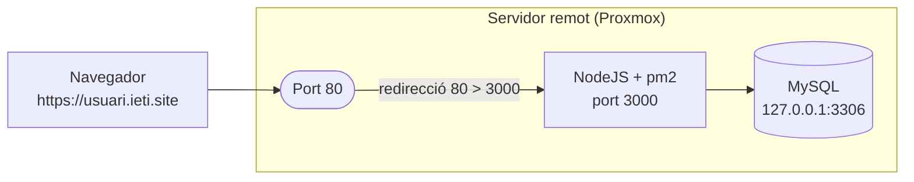

# 01 - Preparar el servidor remot

Anterior: [00 - Claus SSH](./00-claus-ssh.md) | [Tornar a l'índex](../TeoriaProxmox.md) | Següent: [02 - Túnel MySQL](./02-tunel-mysql.md)

Aquest pas **només es fa un cop per servidor**. Deixa el servidor remot amb tot el que necessita per publicar una pàgina web amb NodeJS i una base de dades MySQL.

Abans cal haver completat [00 - Claus SSH](./00-claus-ssh.md).

## Què instal·larem



| Pas | Què s'instal·la | Per a què serveix |
|---|---|---|
| 1 | Dependències, **NodeJS** i **pm2** | Executar el servidor web |
| 2 | **MySQL** i l'usuari *super* | Guardar les dades |
| 3 | **Redirecció** del port 80 al 3000 | Que la pàgina respongui sense haver d'escriure el port |

Les comandes d'instal·lació poden anar lentes. **No talleu la connexió** i llegiu bé els missatges d'error en cas que n'hi hagin.

## Pas 1 - Dependències, NodeJS i pm2

Des de la consola local, a la carpeta **"proxmox"**, connectar amb el servidor:

```bash
./proxmoxConnect.sh
```

Un cop connectats, des de la consola remota:

```bash
sudo apt update
sudo apt install npm rsync iproute2 iptables-persistent
sudo npm cache clean -f
sudo npm install -g n
sudo n latest
sudo npm install -g pm2
```

Comprovar que ha funcionat (cal sortir i tornar a entrar perquè es detecti la nova versió de NodeJS):

```bash
exit
```

```bash
./proxmoxConnect.sh
```

```bash
node --version
pm2 --version
```

## Pas 2 - MySQL

Des de la consola remota, instal·lar MySQL:

```bash
sudo apt update
sudo apt install mysql-server
sudo systemctl status mysql --no-pager
```

L'última comanda ha de mostrar **"active (running)"**.

Connectar a la base de dades des del propi servidor remot:

```bash
sudo mysql
```

Des de la consola 'MySQL' remota, crear l'usuari 'super':

```sql
CREATE USER 'super'@'localhost' IDENTIFIED WITH caching_sha2_password BY '1234';
GRANT ALL PRIVILEGES ON *.* TO 'super'@'localhost' WITH GRANT OPTION;
FLUSH PRIVILEGES;
quit
```

**Nota:** un codi tan senzill com *1234* només és acceptable perquè aquest MySQL **no és accessible des de fora** del servidor. Per connectar-s'hi des del vostre ordinador cal un túnel SSH, explicat a [02 - Túnel MySQL](./02-tunel-mysql.md).

Ja podeu sortir del servidor remot:

```bash
exit
```

## Pas 3 - Redirecció del port 80

Cal que el servidor remot redireccioni les peticions del port 80 al port 3000 (del NodeJS), per respondre a les peticions web.

Aquest pas es fa **des de la consola local**, a la carpeta **"proxmox"**:

```bash
./proxmoxSetupRedirect80.sh
```

Si mai cal desfer la redirecció:

```bash
./proxmoxSetupRedirectUndo.sh
```

## Resultat

El servidor remot ja està preparat. A partir d'ara, el dia a dia és:

- [02 - Túnel MySQL](./02-tunel-mysql.md), per treballar amb la base de dades remota
- [03 - Publicar](./03-publicar.md), per enviar la pàgina web al servidor
