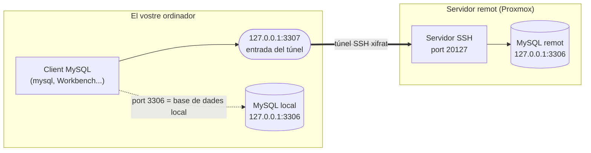
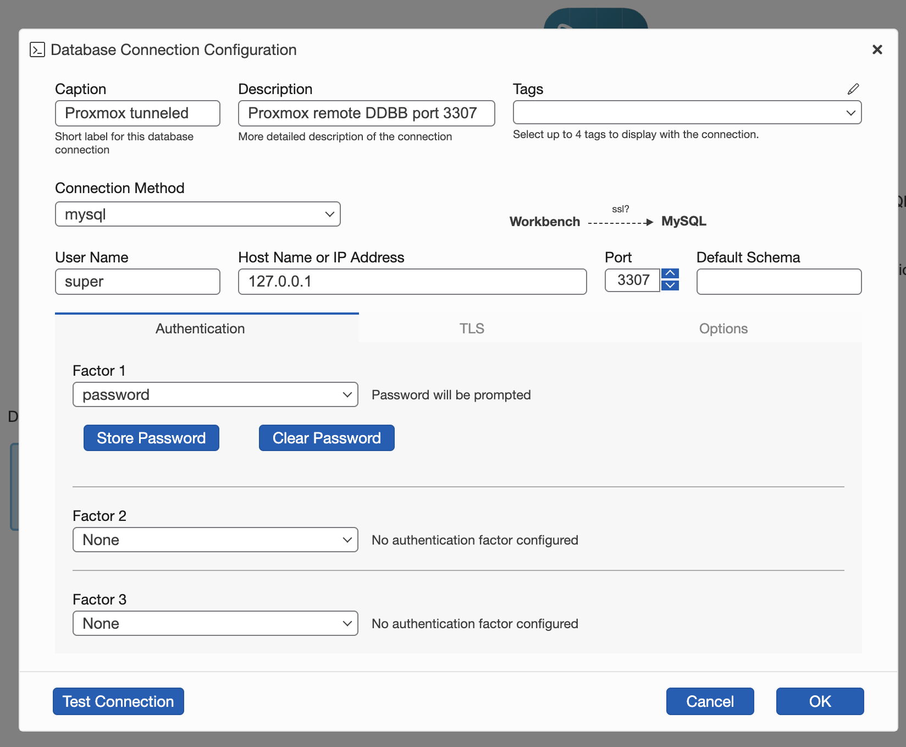
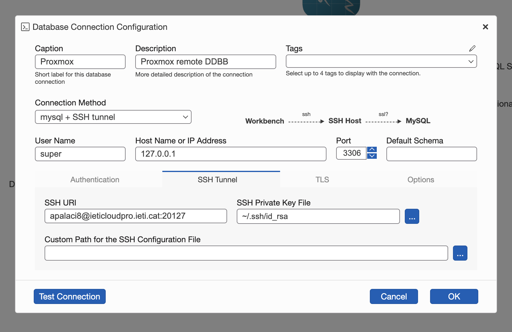
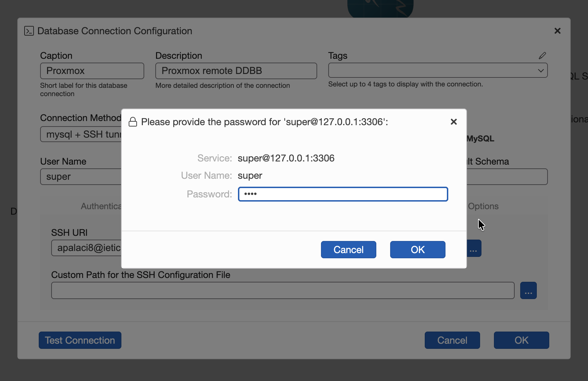

# 02 - Túnel MySQL: connectar a la base de dades remota

Anterior: [01 - Preparar el servidor remot](./01-servidor-remot.md) | [Tornar a l'índex](../TeoriaProxmox.md) | Següent: [03 - Publicar](./03-publicar.md)

Aquests passos es fan **cada cop que voleu treballar** amb la base de dades del servidor remot des del vostre ordinador. Abans cal haver completat [01 - Preparar el servidor remot](./01-servidor-remot.md).

Els scripts s'executen **des de la consola local**, a la carpeta **"proxmox"**.

## Per què cal un túnel?

El MySQL del servidor remot només escolta a la seva pròpia adreça local (**127.0.0.1:3306**). Això vol dir que **no s'hi pot connectar ningú des de fora**, només els programes que funcionen dins del mateix servidor. És una mesura de seguretat: la base de dades no queda exposada a Internet.

L'únic port del servidor al que podem arribar des de casa o des de l'institut és el de **SSH (20127)**. Un **túnel SSH** aprofita aquesta connexió per fer arribar les peticions fins al MySQL remot:

1. S'obre un port al vostre ordinador (**3307**)
2. Tot el que s'envia a aquest port viatja xifrat per la connexió SSH fins al servidor remot
3. El servidor remot ho entrega al seu MySQL (**127.0.0.1:3306**), com si la connexió vingués del propi servidor



## Quin port he de fer servir?

| Adreça i port (des del vostre ordinador) | On arriba la connexió |
|---|---|
| **127.0.0.1:3306** | Al MySQL **local**, el del vostre ordinador (si en teniu) |
| **127.0.0.1:3307** | Al MySQL **remot**, a través del túnel |

El túnel fa servir el port local **3307** i no el 3306, perquè el 3306 normalment ja està ocupat pel MySQL del vostre ordinador. Així podeu treballar amb les dues bases de dades alhora, i només canviant el port decidiu a quina us connecteu.

**Important:** des del vostre ordinador, el host sempre és **127.0.0.1**, mai el nom del servidor remot. Us connecteu a l'entrada del túnel, i el túnel fa la resta.

**Nota:** el servidor (Java) que publiqueu al servidor remot **no necessita el túnel**. Com que funciona dins del mateix servidor, es connecta directament a **127.0.0.1:3306**.

## Obrir, comprovar i aturar el túnel

Des del vostre ordinador, executa la següent comanda per **obrir el túnel**:

```bash
./proxmoxTunelStart.sh
```

El túnel queda funcionant en segon pla, podeu seguir fent servir la mateixa consola.

Executa la següent comanda per **saber si el túnel està obert**:

```bash
./proxmoxTunelStatus.sh
```

Executa la següent comanda per **aturar el túnel**:

```bash
./proxmoxTunelStop.sh
```

Per dins, l'script fa servir l'opció **-L** de la comanda 'ssh', que té el format *portLocal:hostRemot:portRemot*:

```text
ssh -L 3307:127.0.0.1:3306 usuari@ieticloudpro.ieti.cat -p 20127
```

És a dir: *"obre el port 3307 al meu ordinador, i envia tot el que hi arribi cap a 127.0.0.1:3306 vist des del servidor remot"*.

## Connectar a la base de dades remota

Amb el túnel funcionant, podeu connectar-vos a la base de dades remota, però ho heu de fer a la ip local **127.0.0.1** i port **3307**!

```bash
mysql -h 127.0.0.1 -P 3307 -u super -p
```

**Nota:** cal posar **127.0.0.1** i no *localhost*. Amb *localhost* el client 'mysql' ignora el port i es connecta al MySQL local.

Demana el codi (abans hem posat 1234)

```text
1234
```

Des de la consola 'MySQL' remota:

```sql
SHOW DATABASES;
quit
```

## Connectar amb MySQL Workbench

Si la comanda anterior ja us funciona, podeu configurar **"MySQL Workbench"** (o la eina gràfica que volgueu). Hi ha dues maneres de fer-ho, escolliu-ne **només una**.

### Opció A - Amb el túnel dels scripts (recomanada)

El túnel l'obriu vosaltres amb `./proxmoxTunelStart.sh`, i l'eina gràfica es connecta a l'entrada del túnel amb una connexió MySQL normal (sense SSH).

1 - Obrir el túnel i comprovar que funciona:

```bash
./proxmoxTunelStart.sh
```

```bash
./proxmoxTunelStatus.sh
```

2 - Al Workbench, crear una connexió nova amb el mètode **"mysql"** (no *"mysql + SSH tunnel"*):



| Camp | Valor | Explicació |
|---|---|---|
| **Caption** | Proxmox tunneled | El nom que voleu donar a la connexió |
| **Connection Method** | mysql | El túnel ja el fan els scripts |
| **User Name** | super | L'usuari de **MySQL** |
| **Host Name or IP Address** | 127.0.0.1 | L'entrada del túnel, al vostre ordinador |
| **Port** | 3307 | El port local del túnel, **no** el 3306 |
| **Factor 1** | password | *"Password will be prompted"*: el codi es demana en connectar |

3 - Prémer **"Test Connection"** (o **"OK"** i obrir la connexió). Quan demani el codi de l'usuari *super*, escriure **1234**.

Si no voleu escriure el codi cada cop, el botó **"Store Password"** el deixa guardat.

Evidentment, **només funcionarà amb el túnel activat**. Si el Workbench dóna error de connexió, el primer que cal mirar és `./proxmoxTunelStatus.sh`.

### Opció B - Amb el túnel SSH del propi Workbench

L'eina gràfica pot obrir ella mateixa el túnel SSH, i llavors **no cal executar** `./proxmoxTunelStart.sh`. Continua havent-hi un túnel, però el crea i el tanca el Workbench cada cop que es connecta.

A la configuració de la connexió, escolliu el mètode **"mysql + SSH tunnel"** i ompliu les dades a la pestanya **"SSH Tunnel"**:



**Important:** a la captura l'usuari és *apalaci8*. L'heu de **canviar pel vostre usuari de Kamehouse**, que és el mateix que teniu a `DEFAULT_USER` de l'arxiu `config.env`.

| Camp | Valor | Explicació |
|---|---|---|
| **Caption** | Proxmox | El nom que voleu donar a la connexió |
| **Connection Method** | mysql + SSH tunnel | |
| **User Name** | super | És l'usuari de **MySQL**, no el del Proxmox. Aquest **no** s'ha de canviar |
| **Host Name or IP Address** | 127.0.0.1 | Adreça del MySQL **vista des del servidor remot** |
| **Port** | 3306 | Port del MySQL **al servidor remot**, aquí no es fa servir el 3307 |
| **SSH URI** | elVostreUsuari@ieticloudpro.ieti.cat:20127 | El vostre usuari de Kamehouse, amb el port SSH **20127** al final |
| **SSH Private Key File** | ~/.ssh/id_rsa | La clau **privada**, la mateixa de `DEFAULT_RSA_PATH` a `config.env` |

**Atenció:** en aquesta opció el port és el **3306** i no el 3307, perquè la connexió ja surt del túnel **dins del servidor remot**. El 3307 només existeix al vostre ordinador quan el túnel l'obren els scripts.

Premeu **"Test Connection"** (o **"OK"** i obriu la connexió). Apareix una finestra que demana el codi de l'usuari *super* de MySQL. El camp surt buit, hi heu d'escriure **1234** (el codi que vam posar en crear l'usuari) i prémer **"OK"**:



Si aquesta opció us dóna errors de connexió SSH, feu servir l'**opció A**.

## Problemes habituals

| Què passa | Causa més probable | Solució |
|---|---|---|
| *Can't connect to MySQL server on '127.0.0.1:3307'* | El túnel no està obert | Executar './proxmoxTunelStart.sh' i comprovar-ho amb './proxmoxTunelStatus.sh' |
| Veig les bases de dades del meu ordinador i no les del servidor | Connexió feta al port 3306 o a *localhost* | Fer servir **127.0.0.1** i port **3307** |
| *Error: el port local 3307 ja està ocupat* en obrir el túnel | Un altre programa (un MySQL amb Docker, per exemple) ja fa servir el port 3307 | Aturar aquest programa i tornar a obrir el túnel. Per saber quin és: `lsof -nP -iTCP:3307 -sTCP:LISTEN` |
| *Access denied for user 'super'@'172.18.0.1'* (o una altra adreça que comença per 172) | La connexió arriba a un MySQL amb **Docker** del vostre ordinador, no al túnel | Aturar el contenidor que ocupa el port 3307 (`docker ps` i `docker stop nom`) i tornar a obrir el túnel |
| *Access denied for user 'super'* | Usuari o codi incorrectes, o l'usuari no s'ha creat al servidor remot | Repassar [01 - Preparar el servidor remot](./01-servidor-remot.md) |

## Clonar una base de dades local cap al servidor remot

Si teniu una base de dades al MySQL local i la voleu enviar al servidor remot

**Nota:** *canvieu 'nom_db' pel nom de la vostre base de dades*

1 - Obrir el túnel amb `./proxmoxTunelStart.sh`

2 - Crear una còpia de la base de dades local cap a l'arxiu 'dump.sql'

```bash
mysqldump -h 127.0.0.1 -P 3306 -u super -p nom_db > dump.sql
```

3 - Crear la base de dades al servidor remot

```bash
mysql -h 127.0.0.1 -P 3307 -u super -p -e "CREATE DATABASE IF NOT EXISTS nom_db;"
```

4 - Enviar les dades de l'arxiu 'dump.sql' a la base de dades remota

```bash
mysql -h 127.0.0.1 -P 3307 -u super -p nom_db < dump.sql
```

5 - Connectar a la base de dades remota, directament a la base de dades creada/clonada 'nom_db'

```bash
mysql -h 127.0.0.1 -P 3307 -u super -p nom_db
```

Demana el codi (abans hem posat 1234)

```text
1234
```

6 - Des de la consola MySQL remota, comprovar que hi ha les dades/taules esperades al servidor MySQL remot.

```sql
SHOW TABLES;
quit
```
