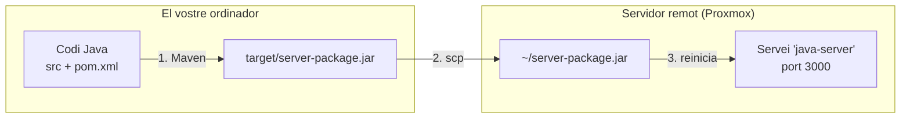

# 03 - Publicar el servidor Java i enviar arxius

Anterior: [02 - Túnel MySQL](./02-tunel-mysql.md) | [Tornar a l'índex](../TeoriaProxmox.md)

Aquests passos es fan **cada cop que voleu actualitzar** el que hi ha al servidor remot. Abans cal haver completat [01 - Preparar el servidor remot](./01-servidor-remot.md).

Totes les comandes s'executen **des de la consola local**, a la carpeta **"proxmox"**.

## Enviar el servidor Java al Proxmox

```bash
./proxmoxDeploy.sh
```

Aquest script fa tots els passos:



1. **Compila** el projecte amb Maven i genera `target/server-package.jar`
2. **Envia** el *.jar* a la carpeta personal del servidor remot
3. **Atura** el servidor Java antic i **arrenca** el nou

El servidor queda funcionant com un **servei del sistema** anomenat *java-server*. Això vol dir que:

- Segueix funcionant quan tanqueu la consola
- Si el programa falla, es torna a arrencar sol
- Si el servidor remot es reinicia, arrenca automàticament

El servidor queda publicat a (canvieu *usuari* pel vostre usuari):

```text
wss://usuari.ieti.site
```

## Què canvia al servidor remot en cada publicació

| Arxiu del servidor remot | Què passa en publicar |
|---|---|
| `~/server-package.jar` | Es **substitueix** per la nova versió |
| `~/output.log` | Es **buida**, per començar amb els missatges de la nova versió |
| Qualsevol altre arxiu o carpeta | **No es toca** |
| Bases de dades MySQL | **No es toquen** |

Si el vostre servidor Java guarda arxius, es conserven entre publicacions sempre que no es diguin `server-package.jar` ni `output.log`.

## Veure els missatges del servidor

Tot el que el servidor Java escriu per consola es guarda a l'arxiu `output.log` del servidor remot. Per veure'l, connecteu-vos:

```bash
./proxmoxConnect.sh
```

Des de la consola remota:

```bash
cat output.log
```

Per veure els missatges a mesura que apareixen (sortir amb *Ctrl+C*):

```bash
tail -f output.log
```

Per saber si el servei està funcionant:

```bash
systemctl status java-server --no-pager
```

## Aturar el servidor Java

Des de la consola local:

```bash
./proxmoxStop.sh
```

El servidor queda aturat i **no torna a arrencar** (tampoc si el servidor remot es reinicia) fins que torneu a executar `./proxmoxDeploy.sh`.

## Enviar arxius al Proxmox

L'script **'proxmoxSendFile.sh'** permet enviar arxius al Proxmox:

Exemple:

```bash
./proxmoxSendFile.sh $HOME/Baixades/nomArxiu.txt
```

L'arxiu queda a l'arrel del servidor.

## Problemes habituals

| Què passa | Causa més probable | Solució |
|---|---|---|
| *Error: cal tenir 'Maven' (mvn) instal·lat* | Falta Maven al vostre ordinador | Instal·lar Maven, veure [Servidor local amb Java](./servidor-local.md) |
| *Error: Maven no ha generat l'arxiu* | El codi no compila | Llegir els errors de Maven que apareixen just abans |
| *el servidor remot no té 'java' instal·lat* | Falta el pas 1 de la preparació | Revisar [01 - Preparar el servidor remot](./01-servidor-remot.md) |
| *el port 3000 del servidor remot està ocupat per un altre programa* | Hi ha un altre servidor funcionant al mateix port, normalment un servidor NodeJS amb **pm2** | Al servidor remot: `pm2 delete app` i `pm2 save`, i tornar a publicar |
| *el servidor no ha arrencat al port 3000* | El programa Java falla en arrencar, o fa servir un altre port | Llegir les línies de `output.log` que mostra l'script i revisar `DEFAULT_SERVER_PORT` a `config.env` |
| El client no connecta però el servidor funciona | Falta la redirecció del port 80 | Executar `./proxmoxSetupRedirect80.sh` |
